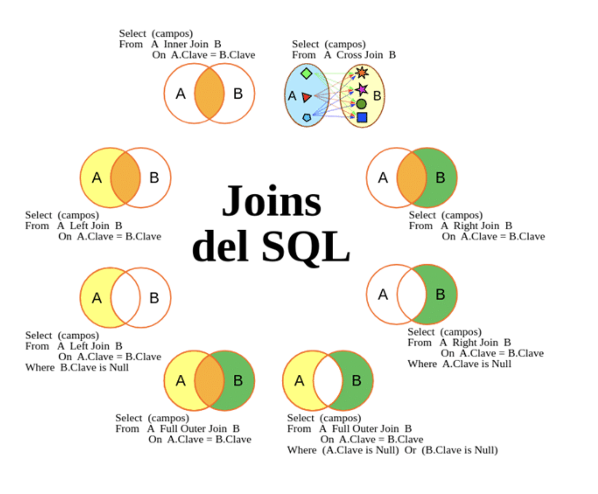

Los cruces son operaciones fundamentales que permiten combinar datos de diferentes tablas según ciertos criterios. 

# ¿Qué es un cruce?
Combinar listas para encontrar coincidencias, basándose en ciertos criterios.

# Inner Join
El INNER JOIN combina registros de dos o más tablas basándose en una condición de coincidencia. Es decir, sólo devuelve los registros cuando hay al menos una coincidencia en las tablas que se están uniendo.

# Left y Right Join
Los LEFT y RIGHT JOIN incluyen todos los registros de la tabla izquierda (LEFT) o derecha (RIGHT) y los registros coincidentes de la tabla derecha o izquierda respectivamente.

Se utiliza cuando se quiere incluir todos los registros de una tabla, independientemente de si tienen correspondencias con la otra tabla

# Union e Intersect
UNION combina los resultados de dos o más consultas en un solo conjunto de resultados, mientras que INTERSECT devuelve sólo los registros que están presentes en ambas consultas. A diferencia de los JOIN que combinan los registros de dos tablas, estas operaciones combinan los resultados de dos consultas.

# Variantes
Existen casos especiales de cruces, como el CROSS JOIN (producto cartesiano) que combina todos los registros de una tabla con todos los registros de otra tabla, sin ninguna condición de coincidencia. 

