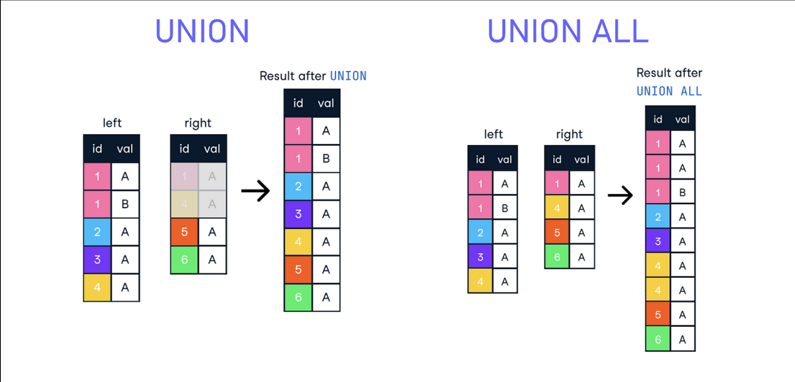
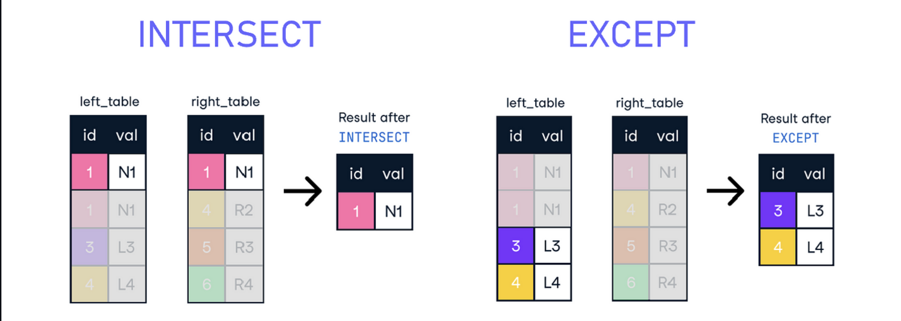

Los cruces son operaciones fundamentales que permiten combinar datos de diferentes tablas según ciertos criterios.

# ¿Qué es un cruce?

Combinar listas para encontrar coincidencias, basándose en ciertos criterios.

# Inner Join

El INNER JOIN combina registros de dos o más tablas basándose en una condición de coincidencia. Es decir, sólo devuelve los registros cuando hay al menos una coincidencia en las tablas que se están uniendo.

Esto significa que devuelve solo los registros que tienen correspondencias en ambas tablas, es decir, donde el valor de la columna coincidente es el mismo en ambas tablas.

# Left y Right Join

Los LEFT y RIGHT JOIN incluyen todos los registros de la tabla izquierda (LEFT) o derecha (RIGHT) y los registros coincidentes de la tabla derecha o izquierda respectivamente.

Se utiliza cuando se quiere incluir todos los registros de una tabla, independientemente de si tienen correspondencias con la otra tabla

LEFT JOIN Devuelve todos los registros de la tabla izquierda (la primera mencionada en la consulta) y los registros coincidentes de la tabla derecha. Si no hay coincidencias en la tabla derecha, se devuelven NULL en las columnas correspondientes de esa tabla.

RIGHT JOIN Devuelve todos los registros de la tabla derecha (la segunda mencionada en la consulta) y las filas coincidentes de la tabla izquierda. Si no hay coincidencias en la tabla izquierda, se devuelven NULL en las columnas correspondientes de esa tabla.

# Union e Intersect

UNION combina los resultados de dos o más consultas en un solo conjunto de resultados, mientras que INTERSECT devuelve sólo los registros que están presentes en ambas consultas. A diferencia de los JOIN que combinan los registros de dos tablas, estas operaciones combinan los resultados de dos consultas.

La cláusula UNION se utiliza para combinar el resultado de dos o más consultas SQL en un único conjunto de resultados. Básicamente, elimina duplicados y combina los registros de los resultados de las consultas en un solo conjunto de resultados. Es importante destacar que las consultas deben tener la misma cantidad de columnas y los tipos de datos deben ser compatibles.

La cláusula INTERSECT se utiliza para combinar los resultados de dos consultas SQL y devolver solo los registros que aparecen en ambos conjuntos de resultados. En otras palabras, INTERSECT devuelve las filas que son comunes en ambas consultas. Al igual que con UNION, las consultas deben tener la misma cantidad de columnas y los tipos de datos deben ser compatibles.

# Variantes

Existen casos especiales de cruces, como el CROSS JOIN (producto cartesiano) que combina todos los registros de una tabla con todos los registros de otra tabla, sin ninguna condición de coincidencia.

FULL JOIN: Devuelve todos los registros cuando hay una coincidencia en una de las tablas específicadas en la cláusula JOIN. Si no hay coincidencias, se devuelven NULL para las columnas de la tabla que no tienen coincidencias.

CROSS JOIN: Devuelve el producto cartesiano de los registros de las tablas combinadas, es decir, combina cada registro de la primera tabla con cada registro de la segunda tabla. No utiliza ninguna condición de coincidencia.

UNION ALL: Similar a UNION, combina los resultados de dos o más consultas en un solo conjunto de resultados. Sin embargo, a diferencia de UNION, UNION ALL no elimina duplicados simplemente concatnena todos los resultados, incluyendo duplicados si los hay.
