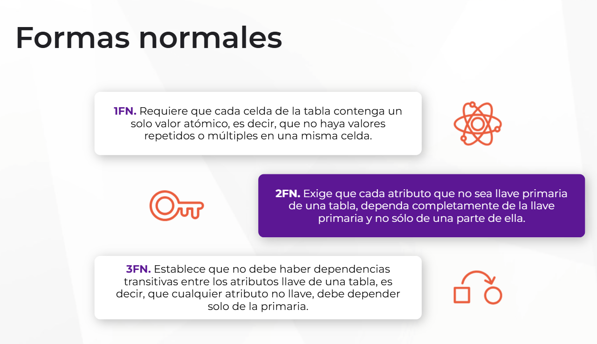
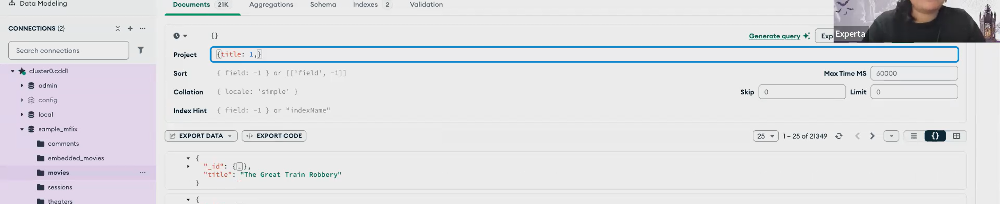
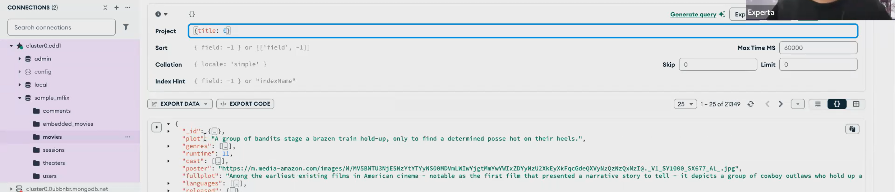
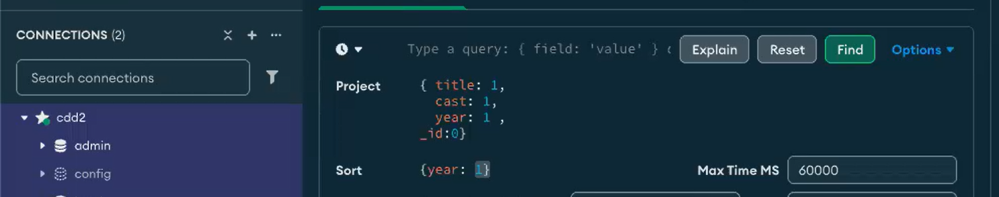

# Diseño básico de bases de datos relacionales
## Modelo Entidad - Relación
El Modelo Entidad-Relación es una técnica de modelado conceptual que permite representar la estructura de una base de datos en términos de entidades, atributos y relaciones. En este modelo, una entidad representa un objeto o concepto del mundo real, como un cliente, un producto o una transacción. Los atributos son las características que describen a cada entidad, mientras que las relaciones muestran cómo se relacionan entre sí las diferentes entidades.

Cada entidad tiene un conjunto de atributos que describen sus características. Las relaciones, por otra parte, establecen conexiones entre entidades y muestran cómo se relacionan entre sí.

## Normalización de datos
La normalización de datos es un proceso fundamental en el diseño de bases de datos, que busca eliminar la redundancia y las anomalías en la información almacenada, asegurando así la integridad y consistencia de los datos. Este proceso se basa en una serie de formas normales, que establecen criterios específicos para organizar los datos de manera eficiente y evitar problemas de actualización y pérdida de información.

Los objetivos de la normalización incluyen:
- Reducir la redundancia: 
- Eliminar las anomalías de actualización
- Mejorar el rendimiento

## Formas normales (1FN, 2FN, 3FN)  

## Creación de tablas en SQL
La creación de tablas en SQL se realiza utilizando la instrucción CREATE TABLE, seguida del nombre de la tabla y la lista de columnas con sus respectivos tipos de datos y restricciones.

### Definición de tipos de datos:
- INT. Para números enteros.
- VARCHAR. Para cadenas de caracteres de longitud variable.
- DECIMAL. Para números decimales con precisión fija.
- DATE. Para fechas.
- BOOL. Para valores booleanos (verdadero/falso).
- BLOB. Para valores binarios grandes, como imágenes o archivos.

### Restricciones de integridad
- PRIMARY KEY. Define una columna o conjunto de columnas, que identifican de forma única cada fila en la tabla.
- FOREIGN KEY. Establece una relación entre dos tablas, asegurando que los valores en una columna correspondan a los valores en otra columna de otra tabla.
- NOT NULL. Especifica que una columna no puede contener valores nulos, es decir, debe tener un valor válido en cada fila.
- UNIQUE. Garantiza que los valores en una columna o conjunto de columnas sean únicos en cada fila de la tabla.
- CHECK. Permite especificar una condición que debe cumplirse para los valores en una columna.

## Llaves primarias y foráneas
Permiten establecer relaciones entre las tablas y mantener la integridad y coherencia de los datos almacenados. 

Una llave primaria es un atributo o conjunto de atributos que identifican de manera única cada fila en una tabla. Su propósito principal es garantizar que no haya duplicados ni ambigüedades en los datos almacenados, lo que facilita la recuperación y manipulación de la información. En cambio, una llave foránea es un atributo o conjunto de atributos que establecen una relación entre dos tablas, indicando que los valores en una columna de una tabla (la llave foránea) hacen referencia a los valores en otra columna de otra tabla (la llave primaria).

# Introducción a NoSQL
Una base de datos NoSQL es una categoría de sistemas de gestión de bases de datos que difiere de las bases de datos relacionales tradicionales en su estructura de datos, modelo de consistencia, escalabilidad y flexibilidad. A diferencia de las bases de datos relacionales, que utilizan un modelo de datos tabular con filas y columnas, las bases de datos NoSQL pueden almacenar datos en diversos formatos, como documentos, pares llave-valor, grafos o columnares.

# Colecciones y documentos
En MongoDB, una colección es similar a una tabla en una base de datos relacional. Es un conjunto de documentos que se almacenan juntos y están organizados de manera lógica. Cada colección puede contener cero o más documentos, y cada documento puede tener una estructura diferente.

# Solo traer ciertas columnas en Mongo DB --PROJECT--
1 para mostrar

# Solo traer la columnas contrarias en Mongo DB --PROJECT--
0 para ocultar

# Ordenar resultados por columna --SORT--
Se pueden poner varios argumentos de filtrado.

1 = ASCENDENTE
-1 = DESCENDENTE

