# Introducción a NoSQL

A diferencia de las bases de datos relacionales, que utilizan un modelo de datos tabular con filas y columnas, las bases de datos NoSQL pueden almacenar datos en diversos formatos, como documentos, pares llave-valor, grafos o columnares.

MongoDB es un Gestor de Bases de Datos no relacionales orientado a documentos que hace uso de la orientación llave/valor.

# Colecciones y documentos

una colección es similar a una tabla en una base de datos relacional. Es un conjunto de documentos que se almacenan juntos y están organizados de manera lógica. Cada colección puede contener cero o más documentos, y cada documento puede tener una estructura diferente.

Por otro lado, un documento en MongoDB es un registro individual dentro de una colección. Un documento puede contener datos de diferentes tipos y puede tener una estructura flexible, lo que significa que los documentos dentro de una misma colección no necesitan tener la misma estructura de campos.

Notar que el campo \_id no es necesario agregarlo, ya que MongoDB Compass lo agrega de forma automática y es la manera en que se crea un identificador único para cada documento. Al final presionar el botón INSERT.

Como MongoDB es una base de datos NoSQL se pueden insertar documentos que no tengan la misma estructura y además cada campo puede tener otro tipo de dato como un arreglo o incluso otro objeto JSON.

En MongoDB los datos son almacenados en colecciones que incluyen documentos.

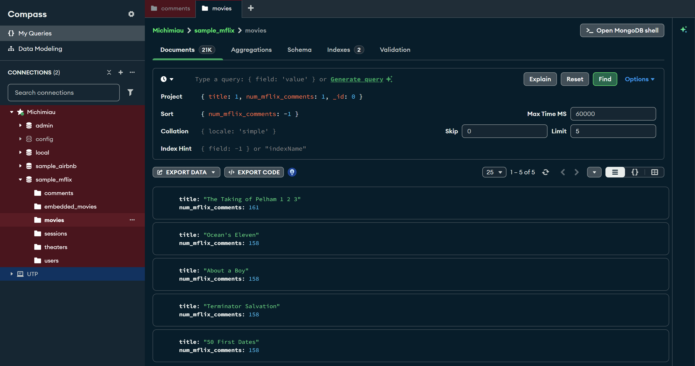

# Expresiones regulares

Una expresión regular es una secuencia de caracteres que define un patrón de búsqueda dentro de una cadena de texto. Permite encontrar coincidencias dentro de un texto basándonos en reglas específicas, como caracteres específicos, patrones de caracteres repetidos o rangos de caracteres.

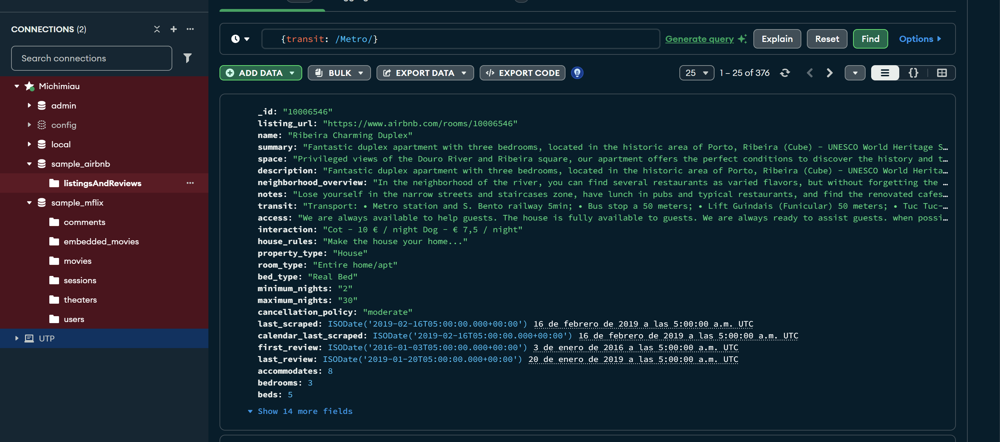
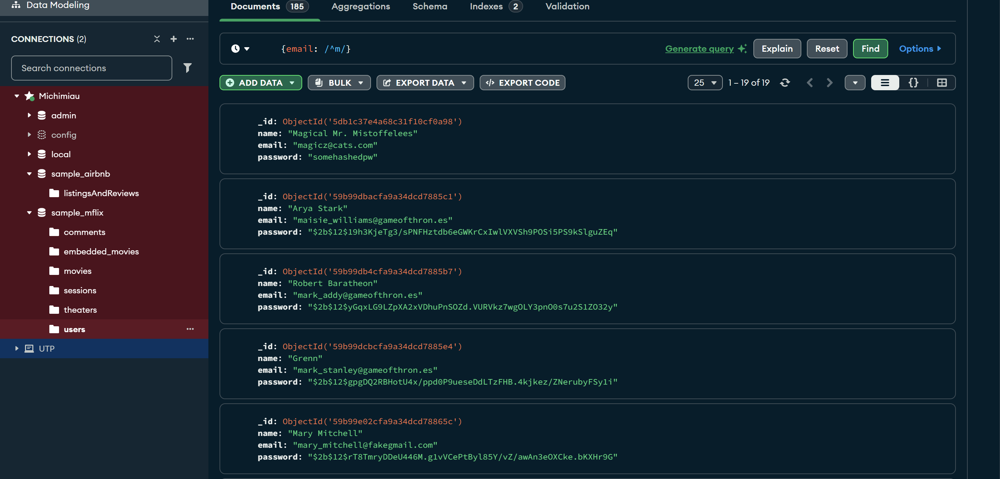
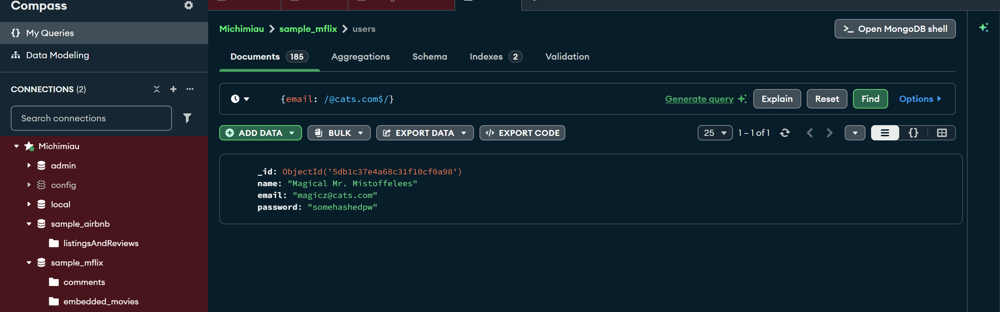
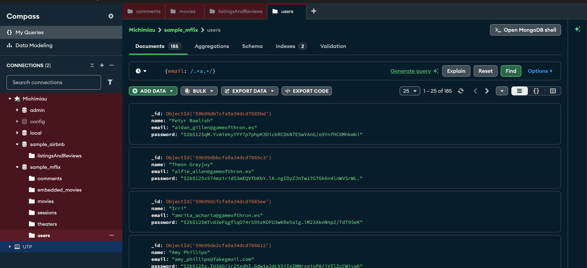

# Ejmplos de regex
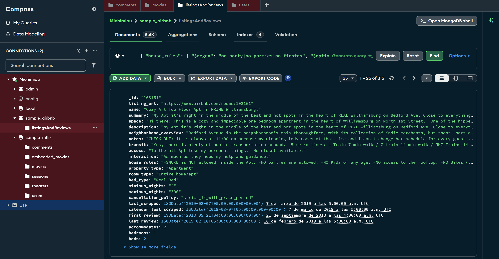
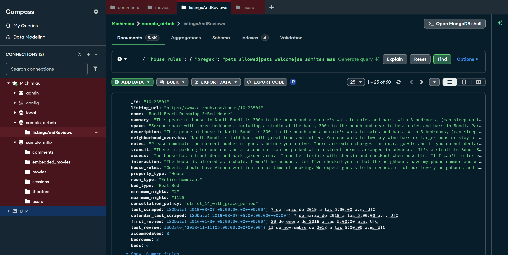
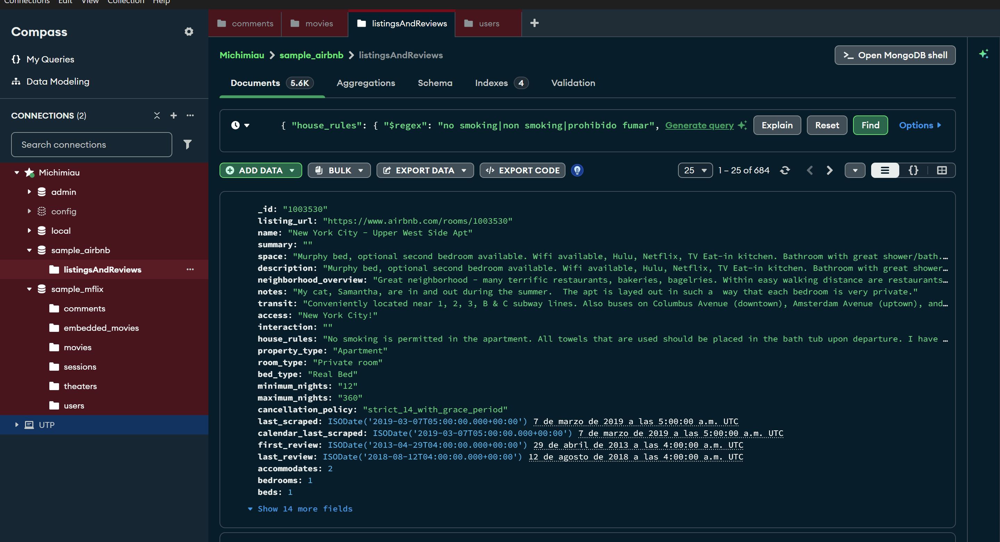
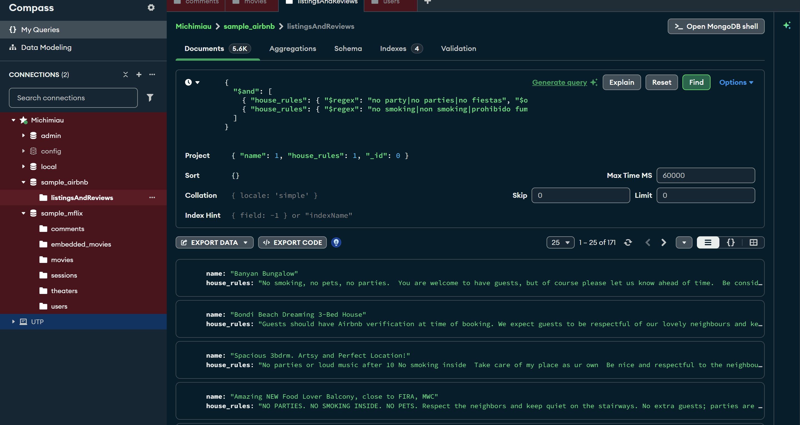

# Objetos dentro de documentos (documento dentro de documento)

La forma de acceder entre un objeto y una lista es diferente
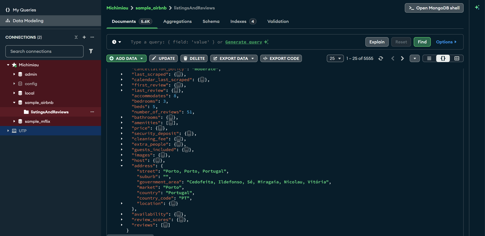
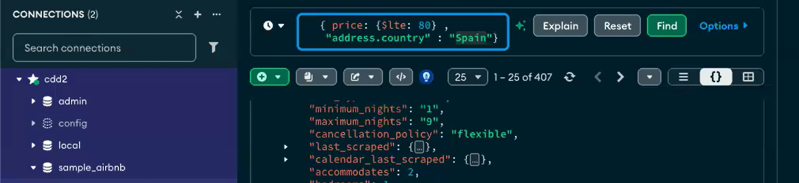

## Acceder a un documento dentro de otro

Se utiliza . para acceder
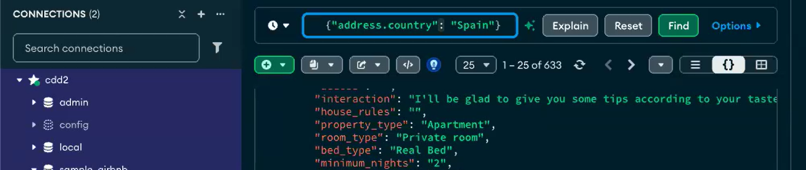

# Buscar parametro en listas

    $in, es decir, algun valor pedido debe ser devuelvo no importa la posicion en el que este

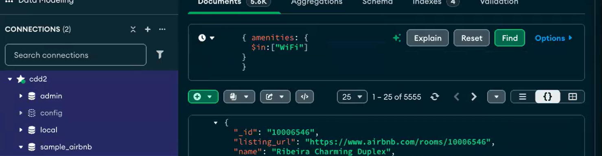

Mas de 2 campos:
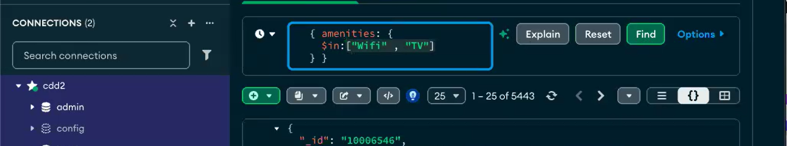

## Filtracion por valor numerico

    $lte = Menor o igual que

    $gte = Mayor o igual que

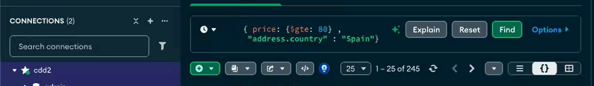

# Varios filtros

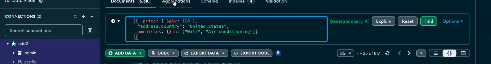
