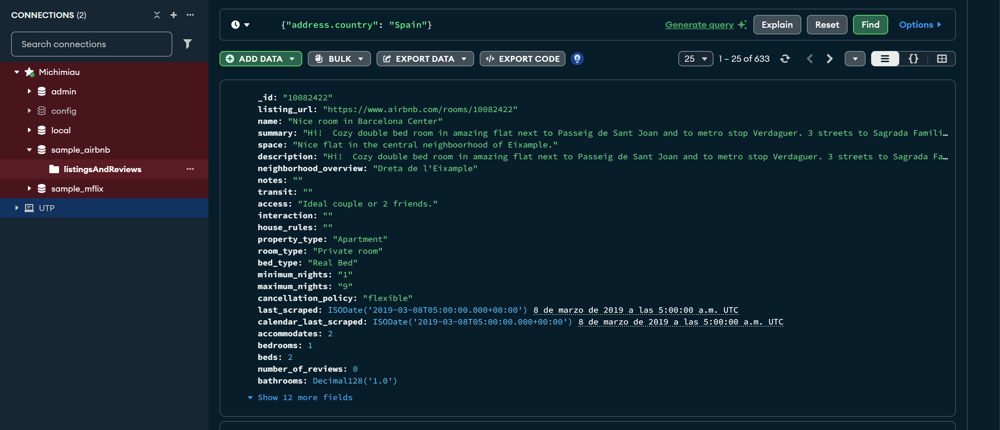
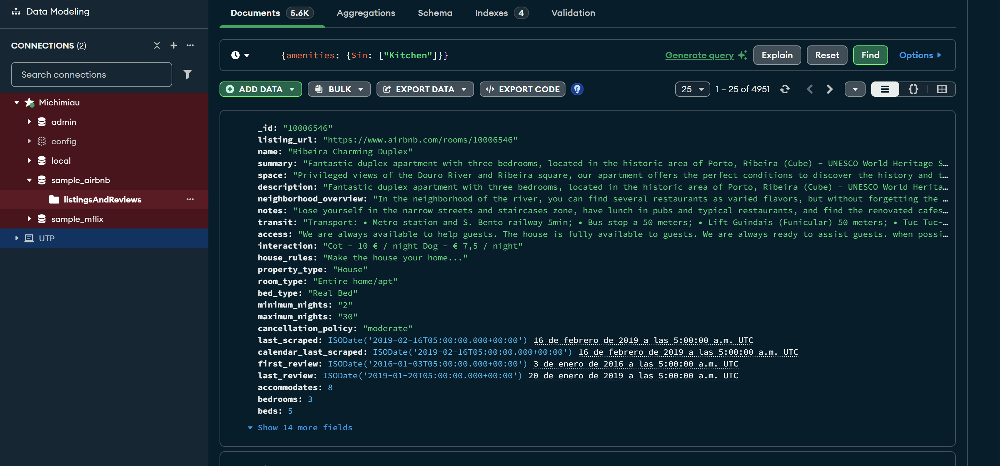
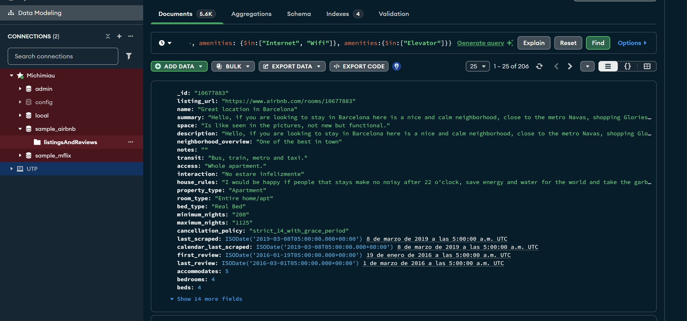
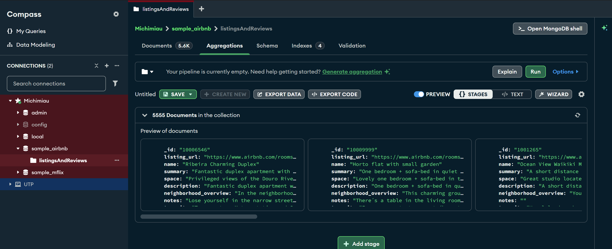
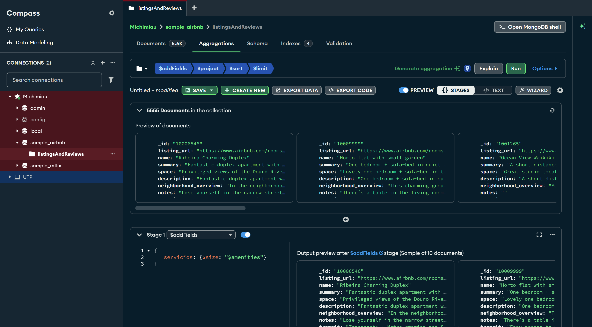
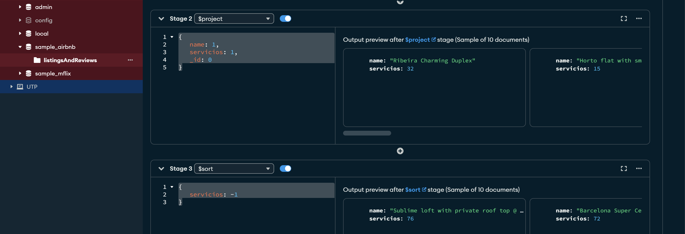
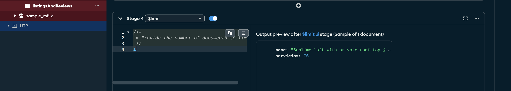

# Notación punto

La notación punto en MongoDB se utiliza para acceder a datos anidados dentro de un documento. MongoDB almacena datos en una estructura de documento similar a JSON, lo que significa que los documentos pueden contener otros documentos y arreglos.

La notación punto es ampliamente usasa en los lenguajes de programación orientados a objetos y permite acceder a los atributos de los mismos.

# Acceso a arreglos

Los documentos en MongoDB pueden contener arreglos, que son listas de valores o documentos. Acceder y manipular estos arreglos es esencial para trabajar con datos complejos.

    “{pedidos: {$in: [“peras”]}}”

# Multicondicional

# Agregaciones

Una agregación se compone de un conjunto de capas que juntas realizan consultas sobre una colección de documentos.

Las agregaciones, permiten realizar distintos filtros usando capas. Una capa es el resultado de la aplicación de algún filtro, proyección, agrupamiento, ordienamiento, etc. Cada capa puede usarse en una nueva capa. La primera capa siempre será la colección completa.

- Pipeline de agregación. Se trata de una secuencia de etapas (stages) que procesan documentos.
- Etapas comunes: $match, $group, $project, $sort, $limit, etc.
- Operadores de agregación. Utilizados dentro de las etapas para definir cómo se deben transformar los datos.

## Agregación - Descripción

- $match: Filtra los documentos para pasar sólo aquellos que cumplen con los criterios especificados
- $group: Agrupa documentos por un campo específicos y puede realizar operaciones de agregación (suma, promedio, etc.).
- $sort: Ordena los documentos por un campo específicado en orden ascendente o descendente.
- $project: Selecciona y renombra los campos a incluir en los documentos de salida.
- $limit: Restringe el número de documentos en la salida a un número especificado
- $skip: Omite un número especificado de documentos en la salida.
- $unwind: Descompone un arreglo de campo en múltiples documentos, uno por cada elemento del arreglo 
$lookup: Realiza una operación de left join con otra colección
- $out: Escribe los resultados de la agregación en una colección específica
- $count: Cuenta el número de documentos que pasan por el pipeline y devuelve el conteo en un nuevo documento.
- $addFields: Agrega nuevos campos a los documentos en el pipeline
- $replaceRoot: Reemplaza el documento de entrada con el documento especificado
- $merge: Combina el resultado de la agregación con otra colección

# Pasos para las agregaciones
1. 
2. 
3. 
4. 

# Agrupamientos
Se realizan mediante la agregación $group

Necesitamos filtrar primero

# Asociación de colecciones
De la misma forma en que SQL incluye distintos tipos de join.
En MongoDB se tiene la operación $lookup que permite relacionar colecciones.

Para facilitar esta búsqueda podemos usar una agregación $lookup que permite asociar dos colecciones. Algo similar a la operación JOIN de SQL.